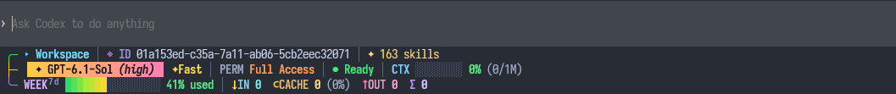
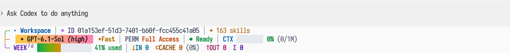

# codex_statusbar_hud

OpenAI Codex CLI **0.163.0**의 입력창 아래에 표시하는 3줄 네이티브 상태바입니다. YAS 스타일의 컬러 프레임, 모델 그라데이션 배지와 사용량 게이지를 Codex TUI 안에서 직접 렌더링합니다.

별도 HUD 창, tmux 패널, 감시 프로세스 또는 SessionStart hook이 필요하지 않습니다. 이 저장소는 비공식 소스 수정본이며 OpenAI의 공식 배포판이 아닙니다.

## 스크린샷

HOME의 Windows Terminal에서 실행 중인 네이티브 Codex CLI를 캡처했습니다. 새 세션의 첫 요청 전 화면이며, 입력창과 HUD 영역만 잘라 사용했습니다. [촬영 정보](docs/screenshots/README.md)

### 다크 테마



### 라이트 테마



## 표시 정보

| 행 | 내용 |
| --- | --- |
| 1 | 실제 작업 폴더명, Git 브랜치·변경량, 세션 ID, 스킬 수 또는 작업 진행도 |
| 2 | 모델·추론 강도, 접근 권한, 실행 상태, 컨텍스트 사용률 |
| 3 | 계정의 7일 한도 사용률, 입력·캐시·출력 토큰, 총 토큰 |

- `WEEK⁷ᵈ`는 계정의 7일 한도 사용률입니다. 주간 누적 토큰 수나 5시간 한도가 아닙니다.
- `⊂CACHE`는 `IN`에 포함된 캐시 입력 토큰입니다. 두 수를 더하지 않습니다.
- 새 세션은 첫 요청 전부터 토큰을 `0`으로 표시합니다. `resume` 시 해당 세션의 사용량을 복원합니다.
- 좁은 터미널에서는 세션 ID와 보조 정보를 줄이고 핵심 정보를 우선 표시합니다.
- 터미널 배경색과 설정된 테마에 따라 밝은/어두운 팔레트를 선택합니다. 실행 프로세스에만 `CODEX_HUD_THEME=light` 또는 `dark`를 지정할 수도 있습니다. 터미널 자체의 배경색은 바꾸지 않습니다.

## 소스와 빌드

`codex/`는 수정된 Codex 0.163.0 전체 소스입니다. HUD 파일의 해시는 `patches/native-source-manifest.json`에서 확인할 수 있습니다. 기존 Rust toolchain, Node.js와 Codex 0.163.0 설치본을 사용합니다. 빌드나 검사가 도구를 자동 설치하지 않습니다.

Windows의 PowerShell 7에서:

```powershell
npm run check
npm test
npm run build
```

빌드는 사용자 홈의 `.codex-hud-target/debug/codex.exe`와 `artifacts/migration-checksums.json`을 생성합니다. 자동으로 설치하지 않습니다.

macOS에서는 `codex/codex-rs`에서 기존 Rust 환경으로 빌드합니다:

```sh
cargo test -p codex-tui --lib rainbow
cargo build -p codex-cli
mkdir -p ../../artifacts
node ../../scripts/build-migration-manifest.mjs state ../../artifacts/migration-checksums.json target/debug/codex
```

## 설치 및 복구

먼저 [운영 안내](docs/OPERATIONS.md)를 읽어 주세요. 설치 도구는 **0.163.0**만 허용하며, 기존 SQLite migration checksum을 읽기 전용으로 대조합니다. 일치하지 않으면 설치를 중단합니다.

Windows 예시:

```powershell
node --no-warnings scripts/install-native.mjs --binary "$env:USERPROFILE/.codex-hud-target/debug/codex.exe" --migration-manifest artifacts/migration-checksums.json
```

출력된 계획을 확인한 뒤 같은 명령에 `--apply`를 추가합니다. 공식 npm vendor 바이너리와 공용 `config.toml`은 보존하고, npm launcher와 별도 관리 폴더를 사용합니다. 실행 중인 세션은 현재 바이너리를 계속 사용하므로 다음 실행 또는 직접 재개 시 새 HUD가 반영됩니다.

## 라이선스와 출처

원본은 [openai/codex](https://github.com/openai/codex)입니다. 이 저장소의 코드는 [Apache-2.0](LICENSE)으로 제공하며 원본의 [LICENSE](codex/LICENSE)와 [NOTICE](codex/NOTICE)를 유지합니다. 디자인은 YAS(`yet-another-statusline`)의 정보 구성과 그라데이션 배지에서 영감을 받았습니다.
